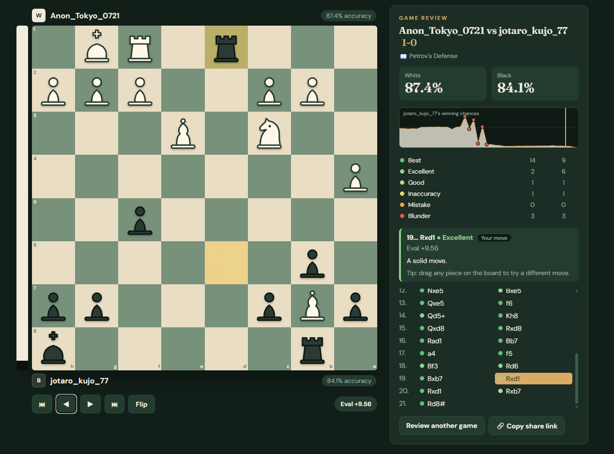

# Chess Review Bot

Game review for your own chess games: paste a PGN or pull your recent Chess.com games, and Stockfish reviews every move. Runs entirely on your computer, free and open source.

## Features

- **Full game review** with Stockfish: move labels (Best to Blunder), accuracy for both players, an eval bar, and an eval graph with mistake markers
- **Chess.com import**: enter a username, pick from your recent games, review with one click
- **What-if scenarios**: drag any piece to try a different move, see how the engine rates it, and watch the engine's best line play out
- **Coach commentary**: plain-English notes such as "you left your bishop on c4 hanging" or "you missed mate". They are generated from the position and the engine data, not by a language model, so they don't make things up
- **Opening names** for common openings, with the theory moves marked
- **Insights** from your last 50 games: win rate by colour, time control and opening, how you lose, and your rating trend
- **Shareable review links**: the whole review is packed into the link itself
- Own board, pieces and theme, all drawn in code

## Download (Windows)
No Python or Stockfish install needed: the zip includes everything (Stockfish is bundled, with its license; see `THIRD_PARTY_NOTICES.txt` for details).

1. Go to the [Releases](../../releases) page and download the latest zip.
2. Unzip it and double-click `ChessReviewBot.exe`.
3. Leave the black window open. It is the local server. Your browser opens the app automatically.

Windows may show a "protected your PC" screen because the app isn't code-signed. The full source is in this repository.

## Run from source

1. Install Python 3.10 or newer, then run `pip install -r requirements.txt`.
2. Download Stockfish from <https://stockfishchess.org/download/> and extract it into this folder. The app finds it automatically in this folder (or up to two folders down), or on your `PATH`. You can also set the `STOCKFISH_PATH` environment variable to the Stockfish folder or exe.
3. Run `python server.py`. On Windows you can double-click `start.bat` instead. The app opens at <http://127.0.0.1:8000>.

There is also a command-line version: `python chess_review.py game.pgn --engine path/to/stockfish --depth 16`

## Build the exe yourself

Double-click `build.bat` (it uses PyInstaller). The app appears in `dist\ChessReviewBot`. Copy your Stockfish folder in next to `ChessReviewBot.exe`, and zip the folder to share it.

## How it works

| Part | Tech |
|---|---|
| Engine | [Stockfish](https://stockfishchess.org/), run as a separate program over UCI |
| Analysis and PGN handling | Python and [python-chess](https://github.com/niklasf/python-chess) |
| Server | FastAPI |
| Front end | Plain HTML, CSS and JavaScript, with [chess.js](https://github.com/jhlywa/chess.js) for move rules |

Move quality uses Lichess's published win-probability and accuracy formulas. The thresholds for the move labels are my own. A higher depth gives a stronger but slower review (14 is the default).

## License and credits

This project is licensed under the **GNU General Public License v3.0**. See [LICENSE](LICENSE). You are free to use, modify and share it, as long as you pass on the same freedoms and keep the license and notices.

It builds on these projects:

- [Stockfish](https://stockfishchess.org/) (GPL-3.0). It is not part of this repository. The Windows download includes an unmodified copy together with its license files.
- [python-chess](https://github.com/niklasf/python-chess) (GPL-3.0 or later)
- [chess.js](https://github.com/jhlywa/chess.js) (BSD-2-Clause), loaded from a CDN
- [FastAPI](https://fastapi.tiangolo.com/), Starlette, Pydantic and Uvicorn (permissive licenses)
- Fonts: DM Sans and Fraunces, loaded from Google Fonts

This is a personal project. It is not affiliated with or endorsed by Chess.com, Lichess or the Stockfish team. It reads games from Chess.com's public API.

## Roadmap

- Best-move arrows on the board
- Browser-only version (Stockfish in WebAssembly) so it can be hosted for free
- Brilliant and Great move labels
- Optional small-language-model "coach voice"
- Smoother piece animations
